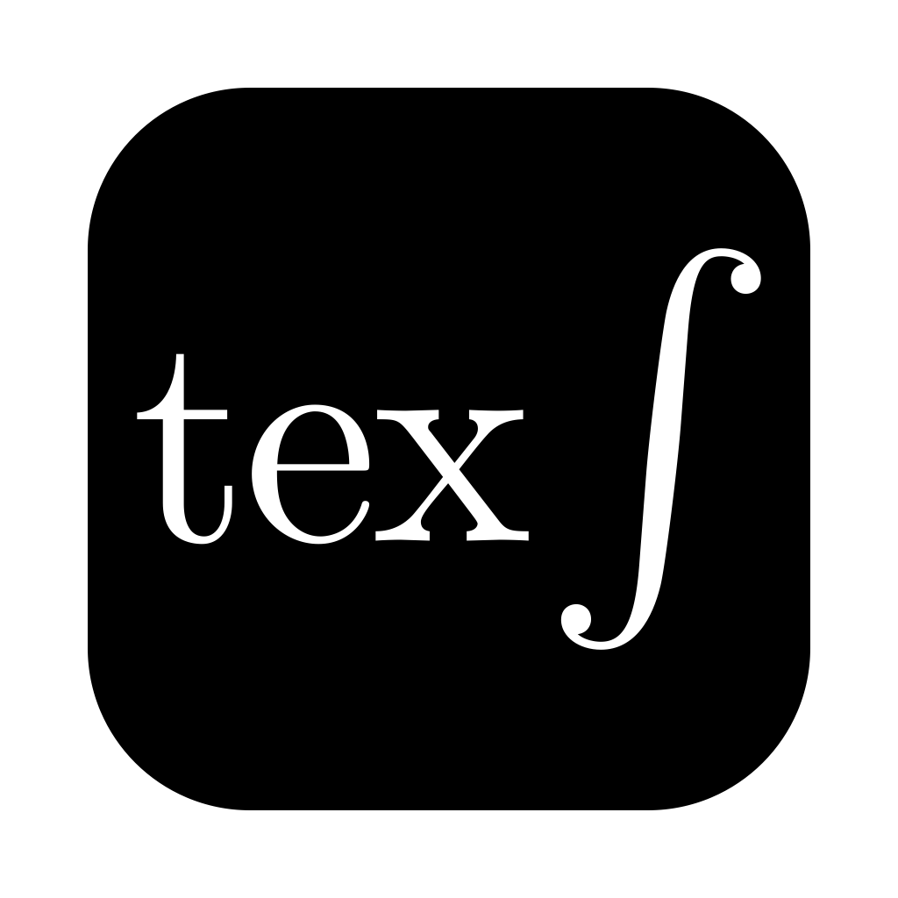
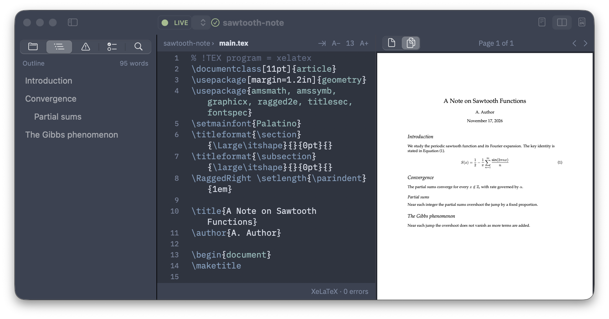

<p align="center">
  
</p>

<h1 align="center">LaTeX Writer</h1>



A small LaTeX editor for the Mac. You type in the middle, and the PDF on the right rebuilds a moment after you stop, using the LaTeX you already have installed (pdfLaTeX, XeLaTeX or LuaLaTeX through latexmk). It completes your labels and citation keys as you type, and a ⌘-click in the PDF takes you back to the source line.

## Build

You need macOS 14 or later, the Xcode command line tools, and [MacTeX](https://www.tug.org/mactex/).

```sh
./make-app.sh
open "build/LaTeX Writer.app"
```

`swift test` runs the tests.

## License

GPL-3.0, see [LICENSE](LICENSE). The bundled IBM Plex fonts are under the SIL Open Font License, see [Fonts/LICENSE.txt](Fonts/LICENSE.txt).
